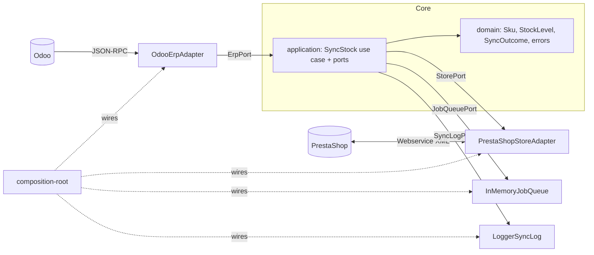

# odoo-store-sync

A hosted synchronization service between **Odoo** (ERP) and **ecommerce stores**, starting with **PrestaShop**.

It reads stock from Odoo through its external API and publishes it to the store by SKU, using an idempotent job queue, retries with exponential backoff and a per-operation sync log. The core is hexagonal, so WooCommerce and Shopify can be added as adapters without touching it.

## Why no Odoo module

Nothing is installed inside Odoo. Everything goes through Odoo's external JSON-RPC API.

- **Odoo Online (SaaS) does not allow third-party modules.** A solution that ships as an Odoo module cannot serve those customers at all.
- **The external API requires the Custom plan** on Odoo Online. It is not available on the One App Free or Standard plans, so customers on those plans cannot use this service either. Odoo.sh and self-hosted instances have no such restriction.

Going through the API keeps one integration path for every hosting model, at the price of that plan requirement.

## Architecture



Dependency rules, checked by review rather than tooling for now:

| Layer | May import |
| --- | --- |
| `domain` | nothing |
| `application` | `domain` and its own `ports` |
| `adapters` | `application/ports` and `domain` |
| `infrastructure` | everything; `composition-root.ts` is the only file that names concrete adapters |

```
src/
  domain/          Sku, StockLevel, SyncOutcome, typed errors (pure, no IO)
  application/
    ports/         ErpPort, StorePort, SyncLogPort, JobQueuePort, ClockPort, LoggerPort, order-import stub
    use-cases/     SyncStock
  adapters/
    odoo/          JSON-RPC client + ErpPort adapter
    prestashop/    webservice client + StorePort adapter
    memory/        in-memory fakes (tests and demo mode)
    logging/       SyncLogPort that writes structured log lines
  infrastructure/  config (zod), JSON logger, retry, system clock, composition root
  main.ts          one-shot CLI
```

## Quick start

Requirements: Node 22+, pnpm 10+.

```bash
pnpm install
pnpm test                      # unit + fixture-based contract tests, no network
SYNC_MODE=memory pnpm sync:stock   # end-to-end demo with in-memory fakes
```

To try it against real systems, start the sandbox and create the credentials:

```bash
docker compose up -d           # Odoo 18 on :8069, PrestaShop 8 on :8080 (first start takes minutes)
```

1. **Odoo**: open http://localhost:8069, create a database named `odoo`, install the Inventory app, and create a few storable products with an **Internal Reference** (the SKU). Then, from the avatar menu, go to *Preferences > Account Security > New API Key* and copy the key.
2. **PrestaShop**: open http://localhost:8080/admin-dev (login `admin@example.com` / `admin12345`, local sandbox only). Go to *Advanced Parameters > Webservice*, enable the webservice, add a key and grant `products: GET` and `stock_availables: GET, PUT`. Make sure the products use the same references as in Odoo.
3. Configure and run:

```bash
cp .env.example .env           # fill in ODOO_API_KEY and PRESTASHOP_WS_KEY, set SYNC_MODE=live
pnpm sync:stock
```

On Windows `cmd` or PowerShell, use the `.env` file rather than the `VAR=value pnpm ...` form.

Exit codes: `0` success, `1` at least one SKU failed or the run aborted, `2` invalid configuration.

Other scripts: `pnpm test:watch`, `pnpm test:coverage` (domain and application are held to 100%), `pnpm typecheck`, `pnpm build`.

## Scope and roadmap

| Item | Status |
| --- | --- |
| Stock Odoo -> PrestaShop, matched by SKU | Done |
| Idempotent queue, retries with backoff, per-operation sync log | Done (in-process queue, log written to stdout) |
| Order import (store -> Odoo) | Planned: port and notes only, see `order-import-port.ts` |
| Durable queue and sync log (Postgres) | Planned |
| Incremental stock reads (via `stock.move`) | Planned |
| PrestaShop combinations and multistore | Planned |
| WooCommerce and Shopify adapters | Planned |
| Fiscal positions and recargo de equivalencia on imported orders | Planned |
| Odoo 19+ support | Planned: Odoo 19 introduces the [External JSON-2 API](https://www.odoo.com/documentation/19.0/developer/reference/external_api.html) (`POST /json/2/<model>/<method>`, bearer API key). The `/xmlrpc`, `/xmlrpc/2` and `/jsonrpc` endpoints used here are deprecated and scheduled for removal in Odoo 22 (fall 2028) |

## Design notes

**Idempotency.** Every stock level becomes a job with the key `${sku}:${quantity}:${sourceVersion}`, where `sourceVersion` is the ERP's own revision marker (Odoo's `write_date`). The queue accepts a key once, so a redelivered or duplicated job is reported as `skipped-unchanged (duplicate-job)` and never touches the store. A key is released when its job fails for good, so the next run can try again. On top of that, the use case compares the store's current quantity with the target and skips the write when they match, which makes re-running a sync safe even when keys differ. Caveat: Odoo does not bump `product.write_date` on stock moves, so in the default mode the version is a weak signal; reading from `stock.quant` (`ODOO_WAREHOUSE_IDS`) uses the quants' `write_date`, which does change.

**Retries.** The queue wraps each job in a retry runner (`infrastructure/retry.ts`): exponential backoff with full jitter, a configurable number of attempts, and a clock port so tests never sleep. Only errors marked `retryable` are retried: network failures, HTTP 429 and 5xx, Odoo database contention. Authentication errors, malformed payloads and unknown errors fail immediately. The sync log records how many attempts each outcome took.

**Logging.** Every outcome (`updated`, `skipped-unchanged`, `not-found-in-store`, `failed`) produces one JSON log line with the SKU, idempotency key, attempts and details such as the quantity change. Log lines and the final table share stdout. Secrets are never logged and configuration errors name variables, not values.

**Data normalization.** Odoo allows negative and fractional on-hand quantities; a shop publishes whole units. Quantities are floored and clamped at zero. Products without an Internal Reference (`default_code`) are skipped and reported once per run.

**PrestaShop details.** A product is found by exact `reference` (MySQL collations are usually case-insensitive, so `abc` matches `ABC`). If several products share a reference the sync fails for that SKU instead of guessing. `PUT` replaces the whole `stock_available` resource, so the client reads it, changes only `quantity` and writes it back. Shops that manage stock with PrestaShop's advanced stock management (`depends_on_stock = 1`) ignore quantity writes.

**Testing.** Strict TDD: tests sit next to the code. Domain and application are covered 100% with in-memory fakes of the ports. Adapters are tested against recorded JSON and XML fixtures served through a scripted `fetch`, so no test touches the network.

## License

MIT, see [LICENSE](LICENSE).
